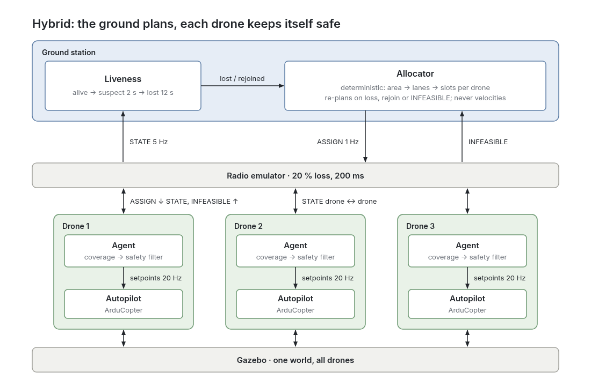
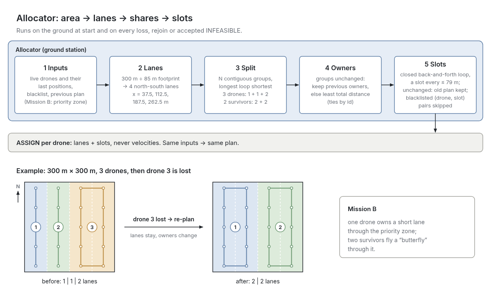
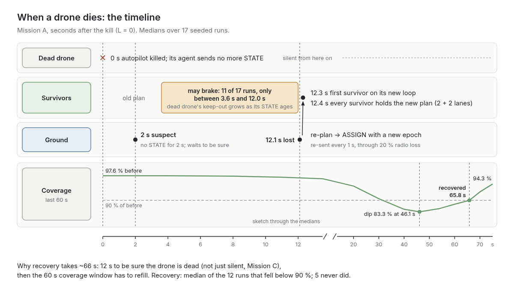

# Resilient multi-drone coverage on ArduPilot SITL

I built a small swarm of three quadrotors. Each runs its own ArduCopter SITL, all in one Gazebo
Harmonic world, and together they keep a 300 m x 300 m area covered with a downward camera
(SIYI A8 mini footprint at 50 m). A ground station gives each drone fixed lanes. Each drone flies
its lanes itself, through an onboard safety filter that keeps it 8 m from the others. Every
message goes through a radio emulator I wrote (20 % loss, 200 ms delay). Then I SIGKILL one
autopilot and measure how much coverage drops and how fast it comes back.

## The problem

- Three drones keep a 300 m x 300 m area watched with downward cameras.
- One drone dies at a random time between 60 and 90 s. It is killed, it does not land.
- Every message goes through a lossy radio: 20 % loss, 200 ms delay.
- The swarm has to notice, split the area again and keep coverage up. Two drones must never
  come within 8 m of each other.
- Mission A is the evaluated one. Mission B adds a 60 m x 60 m zone that must be seen every
  30 s. Mission C silences one drone for 10 s.

## Demo videos

Live runs in Gazebo with the web view beside them. Click a picture to play it on YouTube.

| Mission A (the evaluated one), 2:33 | Mission B (priority zone), 3:14 |
|---|---|
| [](https://youtu.be/5SAeGOS1C4w) | [](https://youtu.be/0mboWFfk0E8) |
| 0:00 the drones take up their loops. 0:17 three drones cover the area. 1:07 drone 1 is killed (SIGKILL, mission time 71.5 s). 1:20 the ground declares it lost (83.8 s) and the two survivors take over its lanes. From 1:30 coverage recovers. | 0:00 the drones take up their loops. 0:25 three drones cover the area; one owns the red 60 m x 60 m zone. 1:28 drone 3 is killed (63.2 s). 1:40 it is declared lost (75.4 s) and the two survivors switch to loops that both pass through the zone. The zone stays covered; the rest of the area settles lower, at about 79 %. |

Each video says its playback speed in the top corner (real time to 1.5x). The required top-down
animation of a Mission A run, under 60 s with the dropout, is `results/replay_representative.mp4` (47 s,
seed 14, the median run).

## Architecture



Hybrid: the ground plans (liveness and the allocator), each drone flies its plan and keeps itself
safe (coverage controller and safety filter onboard). I wanted the part that keeps drones apart
to keep working when the ground or the radio does not.

| Part | Does | Code |
|---|---|---|
| Ground station | liveness, re-plan, lanes and slots (never velocities), mission start | `swarm/ground.py`, `swarm/allocator.py` |
| Radio emulator | UDP relay: 20 % loss, 200 ms delay, blackouts | `sim/radio.py` |
| Per drone, onboard (20 Hz) | coverage controller, 8 m safety filter, GUIDED targets to its own autopilot | `swarm/agent.py`, `swarm/coverage.py`, `swarm/safety.py`, `swarm/mav_vehicle.py` |
| Autopilot + Gazebo | one ArduCopter SITL per drone, iris model in Gazebo Harmonic | `sim/launch.py`, `sim/gazebo_world.py` |

Messages are a small MAVLink dialect (`swarm/swarm.xml`). `run_mission.py` is test equipment: it
starts everything, injects the fault and never sends anything to the swarm.

### Allocator

The ground cuts the area into fixed north-south lanes and hands each drone a loop of slots over
its share; on a loss it only changes who owns which lanes.



In pseudo-code:

```
allocate(alive drones, positions, blacklist, previous plan, priority zone or none):
    lanes  = ceil(area width / camera footprint) north-south lanes, evenly spread
    groups = the cut of lanes into N contiguous groups whose longest loop is shortest
             (try every cut; ties: the first one)
    owners = the previous owners if every group still has its live previous owner,
             else the drone-to-group match with least total distance to the loops
             (ties: the first match over the sorted ids)
    for each drone and its group:
        if same group as before and none of its old slots blacklisted for it: keep the old plan
        else: loop = back-and-forth over its lanes, closed, a slot at most every 79 m
                     (4 start corners, nearest first; take the first with no blacklisted
                      (drone, slot); if all have one, drop those slots from the nearest)
              plan = slots from the drone to the loop's start, then the loop, repeated
    more drones than lanes: spares get no slots and hold
    Mission B: one drone owns a short lane through the priority zone, the rest share
               the other lanes; with two drones, both fly a "butterfly" through the zone
               (where it fits)
    new plans whose first slots come too close to another drone's: move their transit slots
    return {drone: slots}   # deterministic; positions only, never velocities
```

### What happens when something fails

| What fails | Who notices, how fast | What the swarm does | Measured |
|---|---|---|---|
| Autopilot (the Mission A kill) | its agent stops sending at once; the ground declares it lost after 12 s of silence | the ground re-plans the survivors over the dead drone's lanes | lost 12.1 s after the kill |
| Agent process | its autopilot lands after 3 s (heartbeat lost); the ground: lost after 12 s | the same re-plan | lost 12.1 s after the kill, coverage after 95.5 % |
| Payload | the drone lands and reports failsafe; the ground: lost at once | re-plan right away | lost 1.3 to 1.5 s after the failure |
| Ground station | nobody needs it to fly | the drones keep their last plan and stay safe; no re-plan in this version (a leader-follower fallback is my next step; in progress, not in this repo yet) | with a drone also lost: coverage 75.1 % after |
| Radio | each drone is deaf after 3 s of hearing nobody | it stops and holds at its own altitude; no re-plan | 10 s outage: 7.2 s deaf, nobody declared lost |

The scenario runs behind these numbers are in `results/scenarios/` and REPORT.md section 2.

### When a drone dies: the timeline



## Results (Mission A, evaluated)

<!-- numbers: REPORT.md Summary -->
17 seeds (1-17), headless Gazebo, 180 s each. Median [min, max] over runs:

| Metric | Value |
|---|---|
| Coverage, 60 s before the loss | 97.6 % [97.0, 97.8] |
| Coverage after recovery | 94.3 % [92.8, 95.7] |
| Dip | 83.3 % [66.9, 91.5] |
| Recovery time (12 of 17 runs fell below 0.9 x before, all came back; 5 never fell) | 65.8 s [37.2, 77.1] |
| Worst revisit gap, from the loss on | 107.8 s [72.8, 142.5] |
| Lost declared after the kill | 12.1 s [11.8, 12.2] |
| Minimum 3D separation from t = 10 s / time below 8 m | 74.9 m [60.4, 75.0] / 0 s in every run |

- **Mission B** (priority zone): once the survivors' new split runs, the zone is seen within
  30 s in every run; the rest of the area stays at about 79 %
  ([results/gazebo_grid_B/results.md](results/gazebo_grid_B/results.md)).
- **Mission C** (10 s blackout of one drone): it is not declared lost and needs no re-plan
  (`results/scenarios/C_s1.metrics.json`).

Full table: [results/gazebo_50m/results.md](results/gazebo_50m/results.md). Limits, per-victim
numbers and the scenarios: [REPORT.md](REPORT.md).

## Quick start

Requirements:

- Ubuntu 22.04 (tested), Python >= 3.10
- Gazebo Harmonic (`gz sim` 8.x)
- ArduPilot at commit `9165d22419406556fc9815d9f4e3e299e13713a8` and ardupilot_gazebo at
  commit `082a0fe231f6e63bc8d1598f1cba461d9e2ea7f5` (`setup.sh --build` checks out both; another
  ArduPilot commit may refuse to arm)
- `ffmpeg`, `flock` (util-linux)
- Live demo only: MediaMTX for the drone video in the browser

Tested on: Ubuntu 22.04.5 LTS, Python 3.10.12, Gazebo Harmonic (gz sim 8.15.0), ArduCopter SITL
and ardupilot_gazebo at the commits above, MediaMTX v1.21.4 for the live video; a 16-thread laptop
with an RTX 4050. The evaluation runs Gazebo server-only, with no window.

Setup, in this order:

```
sudo apt install git python3-pip python3-venv ffmpeg
# Gazebo Harmonic (its apt source first): https://gazebosim.org/docs/harmonic/install_ubuntu
sudo apt install gz-harmonic libgz-sim8-dev rapidjson-dev libopencv-dev libgstreamer1.0-dev \
    libgstreamer-plugins-base1.0-dev gstreamer1.0-plugins-bad gstreamer1.0-libav gstreamer1.0-gl
# ArduPilot at the pinned commit, and its own prerequisites
git clone https://github.com/ArduPilot/ardupilot ~/ardupilot
git -C ~/ardupilot checkout 9165d22419406556fc9815d9f4e3e299e13713a8
git -C ~/ardupilot submodule update --init --recursive
~/ardupilot/Tools/environment_install/install-prereqs-ubuntu.sh -y
# open a new shell, then, in this repo and with no venv active:
./setup.sh --build      # builds ArduCopter SITL, clones and builds ardupilot_gazebo (pinned)
python3 -m venv --system-site-packages .venv && . .venv/bin/activate
pip install -r requirements.txt pytest
./setup.sh              # checks everything and prints OK / MISSING with the fix for each
```

Build with no venv active: ArduPilot's prerequisites install their Python packages with
`pip install --user`, which a venv does not see. The venv keeps the system site packages so the
live demo sees Gazebo's Python bindings. `ARDUPILOT_HOME` and `ARDUPILOT_GAZEBO` choose where
the two checkouts go (default `~/ardupilot`, `~/ardupilot_gazebo`). `setup.sh` never runs sudo.

Run:

```
./run_eval.sh                      # the evaluation, headless, one run at a time (about 2 h)
./demo.sh A --seed 3               # live demo: Gazebo window + web view on http://localhost:8801
./run_scenarios.sh                 # one run per scenario -> results/scenarios/
python3 -m pytest -q               # fast tests; real-time ones: python3 -m pytest -q -m slow
```

- `run_eval.sh` flies the seeds, one no-loss N = 3 baseline and one no-loss N = 2 reference, then
  writes the table, plots and animation to `results/gazebo_50m/` (raw runs to `runs/gazebo_50m/`,
  git-ignored). Re-running skips finished runs; `FORCE=1` flies them again;
  `SEEDS="1 2 3" ./run_eval.sh` flies fewer. A run counts only if Gazebo's real-time factor is
  at least 0.95; failed attempts are retried and listed in `attempts.txt`.
- `./demo.sh [A|B|C] [--seed N] [--duration S] [--forever] [--no-camera]` (default Mission B).
  The drone cameras need MediaMTX on the PATH (or `MEDIAMTX=`); without it use `--no-camera`.
- One mission by hand: `python3 run_mission.py --mission B --backend gazebo --n 3 --seed 1 --out runs/b1`
  (`--help` for `--victim`, `--kill-at`, `--zone`, `--scenario`). `--backend fake` runs the
  stack without a simulator.

Links:
- Gazebo Harmonic install (Ubuntu): https://gazebosim.org/docs/harmonic/install_ubuntu
- ArduPilot source and its Ubuntu prerequisites: https://ardupilot.org/dev/docs/building-setup-linux.html
- ArduPilot SITL: https://ardupilot.org/dev/docs/sitl-simulator-software-in-the-loop.html
- ArduPilot with Gazebo (ardupilot_gazebo plugin): https://ardupilot.org/dev/docs/sitl-with-gazebo.html
  and https://github.com/ArduPilot/ardupilot_gazebo
- pymavlink: https://github.com/ArduPilot/pymavlink
- MediaMTX (live demo only): https://github.com/bluenviron/mediamtx/releases

## Repository layout

| Path | What |
|---|---|
| `swarm/` | the flight code: ground station, allocator, onboard agent, safety filter, MAVLink dialect |
| `sim/` | Gazebo world, SITL launcher, radio emulator, fake vehicle for tests |
| `analysis/` | offline metrics, plots and animation from each drone's own log |
| `gui/` | web view (`python3 -m gui`): live or replay, camera mosaic |
| `tools/` | demo helpers (`show_gazebo.sh`, camera bridge, run locking) |
| `tests/` | pytest suite, including a golden fake-backend run |
| `results/` | `gazebo_50m/` (the evaluation), `gazebo_grid_A/`, `gazebo_grid_B*/`, `gazebo_payload/`, `lost4/`, `scenarios/`, `replay_representative.mp4` |
| `run_mission.py` | one mission: starts everything, injects the fault, stops everything |
| `run_eval.sh`, `run_scenarios.sh`, `demo.sh`, `setup.sh` | the entry points above |

## More

- [REPORT.md](REPORT.md): what I built for each requirement, all the numbers, the limits.
- [DECISIONS.md](DECISIONS.md): why I chose what I chose.
- [results/](results/): every table, figure and per-run metrics file.
