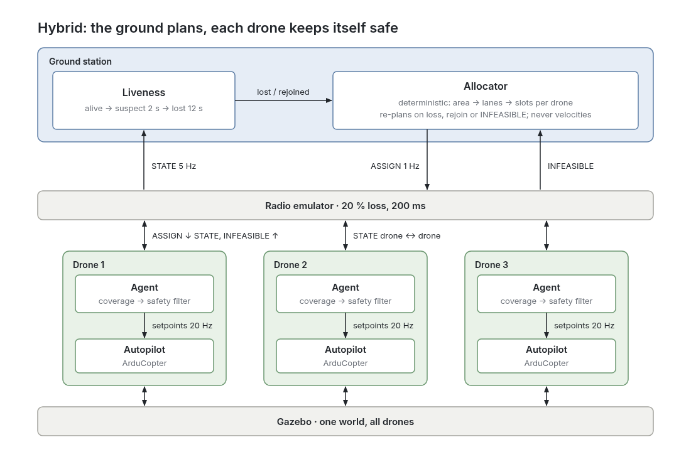

# Report: resilient multi-drone coverage on ArduPilot SITL

For each requirement I say what I built, why, and where the evidence is. Every number comes from a file under `results/`, given as median [min, max] over runs. The reasons for the bigger choices are in [DECISIONS.md](DECISIONS.md).

Conventions:

- The area is 300 m x 300 m, in metres east and north of its south-west corner (`swarm/config.py`).
- Drone ids are 1..N and equal each autopilot's MAVLink system id. The ground station is 255. N = 3 unless stated.
- Mission time t = 0 is 60 s after every drone is on its coverage loop, so the 60 s coverage window is already full at t = 0.
- L is the moment of the loss. P is a run's own coverage in the 60 s before the loss. B is the no-loss three-drone baseline.
- A seed fixes a run's random choices (victim, kill time, dropped packets), so the same seed gives the same faults.

`./setup.sh --build` builds the stack (ArduCopter SITL and ardupilot_gazebo at pinned commits). `./run_eval.sh` runs the whole evaluation headless.

## Summary

Over 17 seeded headless Gazebo runs of Mission A, mean coverage is 97.6 % [97.0, 97.8] in the 60 s before the loss and 94.3 % [92.8, 95.7] after recovery. That is 0.99 [0.94, 1.01] of what a no-loss two-drone run holds, and 1.45 [1.36, 1.47] times the (N-1)/N share the task asks for.

The ground declares the dead drone lost 12.1 s [11.8, 12.2] after the kill and re-plans once. In 12 of 17 runs coverage fell below 90 % of its pre-loss value and came back, after 65.8 s [37.2, 77.1]. In 5 runs it never fell that far. No two drones came closer than 8 m (`results/gazebo_50m/results.md`).

The loss is still visible. The dip is 83.3 % at the median and 66.9 % in the worst run. Some cells go unseen for up to 142.5 s, against about 68 s normally. Losing drone 3, which holds 2 of the 4 lanes, is the worst case: coverage dips to 67-81 % and takes 65-77 s to recover. At 50 m the field is also over-provisioned (a no-loss two-drone run holds 95.1 % against 97.0 % for three), which is part of why the loss looks mild.

So yes, it degrades gracefully, at a cost I chose: a 12 s wait before re-planning, so that a drone that is only silent (Mission C) is not given up.

Mission B: once the survivors' new split runs, the priority zone is seen within 30 s in every run. It is not held during the change-over or when the zone's own drone is lost, and the rest of the area stays at about 79 %. Mission C: a drone silent for 10 s is not declared lost and needs no re-plan.

## 1. Simulation

**What.** Every drone is its own `arducopter` SITL process (SITL is ArduPilot's software-in-the-loop autopilot running on a PC). Instance id is drone id - 1, with MAVLink on TCP 5760 + 10 x instance. All drones fly in one Gazebo Harmonic (robot simulator) world with the ardupilot_gazebo iris model and JSON backend (`sim/launch.py`, `sim/gazebo_world.py`). Lock-step is off: with it on, one killed autopilot froze the whole world. The middleware is plain pymavlink, no ROS (DECISIONS.md, "mavlink for everything"). For tests, the same code also runs on SITL's own physics and on a fake with no simulator.

**GUIDED at 20 Hz.** GUIDED is the mode where the autopilot follows targets sent from outside. Each agent sends one position target per tick at `CONTROL_HZ = 20` (`swarm/config.py`). Measured in every evaluation run: slowest agent 20.0 Hz, worst 99th-percentile setpoint period 0.051 s [0.050, 0.051], longest single period 0.089 s (`results/gazebo_50m/results.md`).

**12 m/s through ArduPilot parameters.** `swarm/mav_vehicle.py` sets `WP_SPD = 11.5` m/s before arming. It reads every parameter back, refuses to arm on a mismatch, and logs the values. I send position targets placed ahead of the drone, not velocity targets, because in GUIDED WP_SPD caps only position targets (measured; see `swarm/mav_vehicle.py`). So the autopilot enforces the cap, not my code.

I chose 11.5 and not 12 because the vehicle overshoots WP_SPD by a small tracking error; a lower `PSC_NE_JERK` keeps it small. Measured maximum ground speed: 11.50 [11.49, 11.50] m/s from the reported velocity, and 11.53 [11.44, 11.99] m/s from position differences over 1 s (`results/gazebo_50m/results.md`). In the grid sets the position-difference maximum reaches 12.01 m/s in some runs (`results/gazebo_grid_A/results.md`). That is 0.01 over the limit on a 1 s difference of reported positions. I report it rather than round it away.

Every failsafe that could choose RTL (return to launch) is set to Land or off (`PARAMS` in `swarm/mav_vehicle.py`). RTL would fly a drone straight across the others' lanes.

## 2. Architecture, and what happens when each component dies

Hybrid. What needs the whole picture runs on the ground. What keeps the drone safe runs onboard.



| Process | Where | Does |
|---|---|---|
| `arducopter` x N | drone (autopilot) | flight control, the speed cap |
| `swarm/agent.py` x N | drone (companion computer) | coverage controller, safety filter, STATE at 5 Hz, its own log |
| `swarm/ground.py` | ground station | liveness, the allocator, the blacklist, START |
| `sim/radio.py` | stands in for the air link | loss, delay, blackouts |

The safety filter and coverage controller are onboard, so they keep working when the ground or the radio fails. The allocator is on the ground because it needs every drone's state and is not time-critical. It sends only lanes and slots, so a late or lost ASSIGN is never dangerous. ASSIGN is re-sent every second and carries an epoch (a plan version number), so a repeat changes nothing.

What happens when one component dies:

- **An autopilot (the Mission A fault).** The agent sees its MAVLink link fail, sends nothing more (so nobody gets a stale position with a fresh time stamp) and exits after 2 s (`swarm/agent.py`). The others mark it suspect after 2 s and lost after 12 s, and the ground re-plans the survivors. Measured: every survivor holds its new plan 12.4 s [12.2, 15.3] after the kill (`results/gazebo_50m/results.md`).
- **An agent process.** Its autopilot loses the agent's heartbeat and lands after 3 s (`FS_GCS_ENABLE = 5`, `FS_GCS_TIMEOUT = 3`). The rest is as above. Scenario `agentdeath`: lost 12.1 s after the kill, one re-plan, coverage after 95.5 %, never below 90 % of before (`results/scenarios/agentdeath.metrics.json`).
- **The payload.** The drone lands itself and keeps talking with status `failsafe`, which the ground treats as lost at once. Lost 1.3 to 1.5 s after the failure in the three runs in `results/gazebo_payload/`, and 1.4 s in `results/scenarios/payloadfail.metrics.json`.
- **The ground station.** The drones keep flying their last assignment and keep hearing each other, so the safety filter works as before. But nothing re-plans, so a drone lost meanwhile leaves its lanes unflown. Scenario `groundloss` (ground down for good from 40 s, then the Mission A kill at 64 s): coverage 97.6 % before, 75.1 % mean after, dip 73.1 %, never recovered; still 1.15 x the (N-1)/N share (`results/scenarios/groundloss.metrics.json`). A restarted ground listens 3 s, jumps its epoch 1000 above any it hears and keeps t0 from its log (tested in `tests/test_ground.py`, not flown). In this version no drone takes over the ground's job.
- **The radio.** After 3 s without hearing anyone a drone is "deaf": it stops and goes to its private hold altitude (cruise is 50 m; hold is 60, 40, 70 m for ids 1, 2, 3), so deaf drones are vertically apart. Scenario `radiooutage` (radio down 60-70 s): 7.2 s deaf per drone, nobody declared lost, no re-plan, mission mean coverage 96.4 %, no time below 8 m (`results/scenarios/radiooutage.metrics.json`).

The ground is the single point of failure for re-planning (see Limitations).

## 3. Sensing

**Payload.** A SIYI A8 mini gimbal camera pointing straight down (`swarm/sensor.py`, which links the product page and manual). It weighs 95 g (SIYI's specification page) and is sold for small multirotors. Horizontal field of view is 81 deg. Every recording mode is 16:9, so the vertical field of view is 51.3 deg (derived). At 50 m above flat ground the footprint is 85.4 m across the track x 48.0 m along it. The rectangle turns with the drone's logged yaw.

**Range and rate: what I assumed.** Anything inside the footprint counts as seen. I do not model resolution, so "seen" means "imaged", not "a person detected". At 50 m the 4K mode gives about 2.2 cm per pixel across (85.4 m over 3840 pixels), so 50 m is the range I use. Coverage uses the positions the autopilot reports at 20 Hz (one log row per control tick), not the camera's frame rate. At 11.5 m/s a drone moves 0.6 m between rows against a 48 m footprint, so the difference is small.

**Coverage only from footprint and logged position.** `analysis/metrics.py` reads only each drone's own log (`agent_<id>.csv`, positions from its autopilot), on a 2 m grid, once a second. A dead drone's rows stop at its loss.

## 4. Allocation

**What.** `swarm/allocator.py` is a pure function of (live ids, last positions, blacklist, previous plan). The area gets fixed north-south lanes one footprint wide: ceil(300 / 85) = 4 lanes at x = 37.5, 112.5, 187.5 and 262.5 m. They are cut into contiguous groups, one per drone, choosing the cut whose longest loop is shortest. With three drones that is 1 + 1 + 2 lanes.

In short:

```
allocate(alive drones, positions, blacklist, previous plan, priority zone or none):
    lanes  = ceil(area width / camera footprint) north-south lanes, evenly spread
    groups = the cut of lanes into N contiguous groups whose longest loop is shortest
             (try every cut; ties: the first one)
    owners = the previous owners if every group still has its live previous owner,
             else the drone-to-group match with least total distance to the loops
             (ties: the first match over the sorted ids)
    for each drone and its group:
        if same group as before and none of its old slots blacklisted for it: keep the old plan
        else: loop = back-and-forth over its lanes, closed, a slot at most every 79 m
                     (4 start corners, nearest first; take the first with no blacklisted
                      (drone, slot); if all have one, drop those slots from the nearest)
              plan = slots from the drone to the loop's start, then the loop, repeated
    more drones than lanes: spares get no slots and hold
    Mission B: one drone owns a short lane through the priority zone, the rest share
               the other lanes; with two drones, both fly a "butterfly" through the zone
               (where it fits)
    new plans whose first slots come too close to another drone's: move their transit slots
    return {drone: slots}   # deterministic; positions only, never velocities
```

Each drone gets its share (a rectangle) and an ordered list of slots: a closed back-and-forth loop over its lanes, like mowing a lawn, with points no more than 79 m apart. Ties break by id, and ids are sorted everywhere. The same inputs give the same plan (`tests/test_allocator.py`).

**Re-plan.** On a lost drone, a rejoin, or an accepted INFEASIBLE report (`swarm/ground.py`). Lanes never move; only owners change. A drone whose share did not change keeps its old plan and epoch. Measured: "changes beyond the one forced by the loss" 0 [0, 0] in every evaluation run (`results/gazebo_50m/results.md`).

**Assignments only.** The allocator outputs shares and slots. SWARM_ASSIGN has one more field, a speed limit, used only by the Mission B phase hold (below) to slow one drone to 0.8 or 0.6 x cruise. It is a cap the coverage controller respects, not a velocity command, and the safety filter still sits after it. In Mission A it is always 0 (= cruise).

Why fixed lanes and three drones: DECISIONS.md, "Why 3 drones and not 4 or 5".

## 5. Coverage and redistribution

**Coverage controller** (`swarm/coverage.py`, onboard). It flies straight at the active slot at cruise, slowing only before sharp turns, and moves on when within 5 m of it or past it, looping after the last slot. On a new plan it starts at the slot it already heads to, or the nearest one ahead, so a re-plan does not turn it round. Its output is a horizontal velocity; the safety filter decides what reaches the autopilot.

**Redistribution.** When a drone is lost, the two survivors split the four lanes 2 + 2. The first survivor is on its new loop 12.3 s [12.1, 12.4] after the kill (`results/gazebo_50m/results.md`). `assignments.png` in each results set shows the shares over time: one step at the re-plan, flat otherwise.

Why 12 s: DECISIONS.md, "Dead or just silent?". `results/lost4/` flew seeds 1-5 with 4 s: loss is declared about 4 s after the kill, but in Mission C the silent drone is declared dead and comes back, costing two re-plans.

## 6. Safety filter

**Where.** `swarm/safety.py`, onboard, every tick, between the coverage controller and the autopilot. It uses only the drone's own state from its autopilot and the last SWARM_STATE heard from each neighbour. It has no I/O, so `tests/test_safety.py` drives it directly.

**What it enforces.** Any two drones at least 8 m apart in 3D. For each neighbour, either their altitude bands are 8 m apart (a drone only ever targets cruise or its own hold altitude, 10 m apart), or the filter stays out of a keep-out disc around the neighbour's predicted position and closes on it no faster than it can still stop. Both drones of a pair apply the same rule and each takes half.

**Stale states.** The disc grows with the age of the neighbour's last state: 9.0 m when fresh, 14.5 m at 1 s, 28.1 m at 2 s, 64.5 m at 4.6 s (by then a silent neighbour has itself gone deaf and braked), up to 88.5 m (computed from `SafetyParams.radius_m`). Late or out-of-order states are ignored. A neighbour silent for 12 s is dropped. A neighbour in failsafe is landing, so only the air above its last height is free.

**Brake and deaf.** If the drone could not stop before a disc at its actual velocity, the filter commands zero (`brake`). A deaf drone (section 2) holds zero horizontal speed at its hold altitude until it hears someone and is clear again.

**When it cannot satisfy every constraint.** Each disc sets a maximum closing speed. The filter first removes the excess closing speed toward each disc, with a step to the right in a head-on case. If that breaks another disc's limit, it scales the whole velocity down until none is broken, down to zero if needed. So when constraints conflict, the drone slows and stops; it does not escape sideways. Coverage gives way, separation does not.

A drone held still like this reports its slot infeasible after 15 s, goes to its hold altitude (clear of the cruise layer) and the ground re-plans around it (section 7). Inside a disc it may never close further, but nothing pushes it out either.

**Take-off is outside the filter.** A drone climbs straight up to its hold altitude only after listening 1 s and seeing no neighbour within 9 m horizontally (8 m plus position error). The start line is 10 m apart, so take-off is clear by construction.

**Evidence.** In the normal Gazebo flights the drones never came close. Minimum 3D separation from t = 10 s was 60.4 m or more in the evaluation and 24.2 m or more across every other Gazebo set in `results/` (the lowest is in `gazebo_grid_B_old`). Time below 8 m is 0 s everywhere. The 10.0 m minimum over the whole flight is the start line on the ground. `tests/test_safety.py` covers the hard cases, including head-on crossings at cruise and a 10 s blackout while a neighbour approaches.

To test the filter in flight, the `headon` scenario sends the two closest drones straight at each other at the same 50 m cruise altitude; without the filter they would pass at about 0 m. In Gazebo they passed at 23.9 m, with no time below 8 m. The filter braked for 0.25 s and 0.40 s, and the two got past each other with no deadlock (`results/scenarios/headon.metrics.json`, `headon_separation.png`). The pass is wide because the keep-out disc grows with the age of each position report and leaves room to stop. This is one run on one seed, so it shows the filter working in a real encounter, not a measured safety margin. The `obstacle` scenario also exercises it in Gazebo (section 7).

**Why the logs show braking.** The summed `brake` time per evaluation run is 0.4 s [0.0, 13.9] over all drones (`results/gazebo_50m/results.md`); 11 of 17 runs brake at all. All of it falls between L + 3.6 s and L + 12.0 s, after the kill and before the dead drone's state is dropped. The cause is the dead drone's keep-out disc: its last state ages, so the disc grows (88.5 m at 12 s), and the brake rule assumes the neighbour takes half of the avoidance, which a dead drone does not. So survivors brake once the disc edge is about 100 m away. The braking drones were 76 to 202 m from the dead drone and 71 m or more from any live one. This is the price of not knowing whether a silent drone is dead or still flying: a little coverage before the re-plan, nothing in separation.

## 7. Feasibility feedback

**Detection.** A slot not reached 15 s after it became active is infeasible (`swarm/coverage.py`). Slots are at most 79 m apart, under 10 s from a standing start, so an unblocked drone always makes it. The timer pauses while the drone is deaf, but not while the safety filter blocks it: a blocked slot is exactly what the ground must hear about. The drone then holds and repeats SWARM_INFEASIBLE every second until a newer epoch arrives.

**No reissue, no oscillation.** The ground accepts the first report, blacklists the (drone, slot) pair for 60 s and re-plans. Repeats are ignored, and a report survives an unrelated re-plan (`swarm/ground.py`). The allocator never issues a blacklisted pair; it re-spaces that leg's points to step around it. When the blacklist expires nothing re-plans. Unchanged shares keep their plan, so other drones see no churn (assignment changes).

**Evidence.** Scenario `obstacle`: an obstacle only one drone knows about appears on one of its loop slots at 30 s, in a 240 s run so the blacklist expires inside it. The filter held the drone at the obstacle's edge (16.9 s braking) and the slot timed out. The ground accepted one INFEASIBLE, ignored none and re-planned once: churn 0.08 changes per drone per minute, coverage 97.0 % mean, no second report after the expiry (`results/scenarios/obstacle.metrics.json`). Unit tests: `tests/test_coverage.py`, `tests/test_ground.py`, `tests/test_allocator.py`.

## 8. Faults and comms

**The kill.** `run_mission.py` sends SIGKILL to the victim's `arducopter` at a seeded time in [60, 90] s; the seed picks the victim too. No landing, no goodbye. In Gazebo the dead model is then removed from the world (`sim/launch.py`): otherwise the ardupilot_gazebo plugin waits for an autopilot that never answers, and it slowed the whole world to about 0.6 x real time.

**The radio.** `sim/radio.py` is one UDP relay. Every node sends every MAVLink packet to it. It drops each copy per receiver with probability 0.2 and forwards the rest 200 ms later. Each (sender, receiver) pair has its own seeded random stream, so the k-th message from A to B is dropped in every run of a seed or in none. Measured over the evaluation: loss 20.0 % [19.4, 20.5], mean delay 0.200 s, max 0.203 [0.201, 0.224] s (`results/gazebo_50m/results.md`, from each run's `radio.jsonl`). Messages are a small MAVLink 2 dialect, 51 bytes for a state (DECISIONS.md).

**No side channel.** Agents talk to their own autopilot over TCP and to everyone else only through the radio (`swarm/protocol.py`, `swarm/net.py`). The runner reads `ground.jsonl` only to learn t0 for the fault schedule and never sends to the swarm. Gazebo knows every position, but only the live view reads it, and the evaluation never starts it.

**Stale states.** The safety filter acts on the last state received from each neighbour, aged from its time stamp (section 6).

## Evaluation: Mission A

`./run_eval.sh`: 17 seeds (1-17), 180 s each, plus one no-loss N = 3 baseline and one no-loss N = 2 reference. Definitions are in `analysis/metrics.py` and at the top of `results/gazebo_50m/results.md`. "Before" is the 60 s before the loss. "After recovery" is from the recovery time to the end of the run.

Seeds 1-17 are all reported, none left out. The seeds lose drone 1 six times, drone 2 five times and drone 3 six times.

| Metric | Before the loss | After recovery |
|---|---|---|
| Coverage, mean (%) | 97.6 [97.0, 97.8] | 94.3 [92.8, 95.7] |
| Coverage, lowest (%) | 95.7 [94.3, 95.8] | 88.4 [87.6, 91.5] |
| Worst revisit gap (s) | 67.7 [67.5, 69.0] | 107.8 [72.8, 142.5] (from the loss on) |
| Steady revisit gap (s) | 67.4 [58.2, 69.0] | 68.0 [67.1, 71.0] (from lost declared on) |
| Recovery time (s) | - | 65.8 [37.2, 77.1] over the 12 runs that fell below 0.9 x P; 5 runs never did |
| Assignment churn (changes / drone / min) | 0.00 [0.00, 0.00] | 0.31 [0.26, 0.59] (from the loss on) |

Coverage from L + 60 s, when the dead drone's last sightings have left the window: 93.9 % [89.0, 95.7]. Mean over the whole mission: 94.6 % [89.2, 96.4].

- **(N-1)/N check.** (N-1)/N x P is 65.1 % [64.7, 65.2], and after recovery is 1.45 [1.36, 1.47] times that. This check is easy at 50 m: even the lowest dip of any run, 66.9 %, is above it. The harder comparison is the no-loss two-drone run (one run, like the baseline): after recovery is 0.99 [0.94, 1.01] of it. Measured against the no-loss baseline B instead of each run's own P, 5 of 17 runs never fell below 0.9 x B; 12 did and all came back, in 65.3 s [36.2, 76.4].
- **Recovery** means coverage back within 10 % of its pre-loss value and staying there. The dip is 83.3 % [66.9, 91.5] and comes late, 46.1 s [26.3, 115.9] after the loss, because coverage has a 60 s memory: the dead drone's last sightings fade out of the window while the survivors are already on their new loops.
- **Worst revisit gap** (longest time a cell goes unseen). Before the loss it is about the 2-lane loop's period, 67.7 s. Over the loss, cells on the dead drone's lane wait up to 107.8 s [72.8, 142.5]. Once the new split runs, the steady gap is back to 68.0 s.
- **By victim.** Losing drone 3, which flew two lanes, hurts most: coverage from L + 60 s is 91.5 % [89.0, 93.6] and recovery 65 to 77 s, against 94.9 % (drone 1) and 94.0 % (drone 2).
- **Safety and control.** Minimum 3D separation from t = 10 s: 74.9 m [60.4, 75.0]. Time below 8 m: 0 s in every run. Setpoints: 20.0 Hz for the slowest agent in every run.

**Per drone and fault time** (`results/gazebo_grid_A/`, flown on commits c68ee22 and f459190): each drone killed at 60, 70, 80 and 90 s, 12 runs. Before 97.5 % [97.2, 97.8], after recovery 94.5 % [91.6, 95.8], after / N-1 reference 0.99 [0.96, 1.00], recovery 63.8 s [51.0, 74.8] over the 9 runs that fell below, churn after 0.32 [0.25, 0.67]. `by_drone.png` shows it per drone and fault time.

Figures in each set: `coverage_vs_time.png`, `before_after.png`, `recovery_steps.png`, `age_maps.png`, `assignments.png`, `separation.png`. The animation is `results/replay_representative.mp4` (47 s, top-down, includes the dropout): seed 14, the median run by coverage after recovery (94.3 %). Drone 3 is lost at 63.2 s and coverage dips to 80.5 %.

## Mission B: priority zone

**Limits first.** The 60 m x 60 m zone is seen at least every 30 s while all three drones fly and once the new split has settled. It is not held in these cases:

- During the change-over after a loss (about 40 s), the zone can go a few seconds over 30 s unseen: up to 33.8 s when drone 1 or 3 is lost (whole run, mean [min, max] over that victim's 4 runs: 28.7 s [26.5, 33.8] and 27.7 s [26.5, 30.6]).
- When the drone that flies the zone is the one lost, the zone waits for the 12 s lost timeout plus the survivors' travel: 50.3 s [42.8, 57.3] (mean [min, max], 4 runs) when drone 2 is lost (58.7 s in the no-hold set).
- During a blackout of 10 s or more of the zone drone: it holds deaf and nothing re-plans.
- With one survivor only the zone strip is covered.

**What.** With three drones, one flies a short out-and-back lane through the zone, its ends close enough to the zone centre (126.5 m) to be back within the 30 s. The other two share the rest. Two survivors fly a "butterfly" instead, each a two-lane loop: north on a centre lane 8 m beside the zone centre, then south on a wing lane one footprint further out. Both centre lanes see the whole zone. The two drones are kept half a lap apart, so the zone is seen twice a lap (`swarm/allocator.py`). The half lap is set at the re-plan from a predicted transit, and in Gazebo it came out up to 8 s off. So the ground runs a phase hold: the drone too close behind the other gets a speed limit of 0.8 x cruise (0.6 x when more than 3 s off) until they are half a lap apart again.

**Results** (each drone killed at 60-90 s, 12 runs per set):

| Set | Zone longest unseen (s) | Zone oldest from L + 40 s (s) | Coverage from L + 60 s (%) |
|---|---|---|---|
| `gazebo_grid_B` (butterfly, phase hold) | 29.3 [26.5, 57.3] | 23.9 [23.3, 26.1] | 79.0 [76.3, 81.1] |
| `gazebo_grid_B_nohold` (butterfly, no hold) | 30.6 [26.4, 58.7] | 26.0 [22.9, 31.9] | 79.1 [77.1, 81.9] |
| `gazebo_grid_B_old` (one zone owner) | 27.3 [26.5, 65.4] | 26.2 [26.2, 27.2] | 68.6 [64.5, 73.4] |

The old split held the zone but left the rest at 68.6 %, close to the (N-1)/N line. The butterfly lifts that to about 79 % even without the hold. With the phase hold, once the new split runs (from L + 40 s), the zone's oldest cell is 23.9 s [23.3, 26.1], under 30 s in all 12 runs (no hold: up to 31.9 s). The 58.7 s maximum in the no-hold set is the zone drone's own loss (victim 2). `compare.png` in `gazebo_grid_B/` puts the sets side by side. `gazebo_grid_B` was flown on the final code (dcc35c7).

Outside the zone the loss is not recovered. Coverage falls from 100 % before the loss to about 79 %: 0 of 12 runs recover to 0.9 x P in every Mission B set.

## Mission C: comms blackout

Every message to and from one drone is dropped for 10 s. With the 12 s lost timeout the silent drone is never declared lost. It goes deaf after 3 s, holds 7.2 s at its hold altitude, and is back on its loop 1.7 s after the blackout. No re-plan; mission mean coverage 97.7 % (`results/scenarios/C_s1.metrics.json`).

With a 4 s timeout the same run declares it lost and re-plans, then re-plans again when it rejoins. It is back covering 4.8 s after the blackout (`results/lost4/C_s1.metrics.json`, an earlier commit with the same code). Telling silent from dead over the radio alone needs a timeout longer than the longest silence. DECISIONS.md explains the numbers and a camera-based check I tried and dropped.

## Live demo (not part of the evaluation)

`./demo.sh` runs one mission with the Gazebo window, scenery, live drone cameras and the web view (`python3 -m gui`). None of it runs in the evaluation or feeds the swarm.

## Limitations and next steps

- **Lane tracking.** The coverage controller flies at slots, not along the lane line. Tracking the lane would make footprint overlap more predictable.
- **The ground is a single point of failure for re-planning.** While it is down, a lost drone's lanes stay unflown (75.1 % in `groundloss`). Next step, designed and in progress on a separate branch, not part of this submission: a leader-follower fallback. If the drones hear no ground for 10 s, the lowest-id live drone (its MAV_SYSID) runs the same ground code onboard and sends the plans over the radio. If it dies, the next lowest takes over. A returning ground takes back control with a higher plan epoch.
- **No EKF under Gazebo.** The EKF is the autopilot's position estimator. The JSON backend sets `AHRS_EKF_TYPE 10`: positions are the simulator's truth, so GPS faults and estimate errors are not exercised.
- **The dead drone is removed from Gazebo**, so the others never meet a falling airframe.
- **N = 3 only.** More drones would degrade more gently (DECISIONS.md). The allocator handles any N, but I flew only three.
- **Small samples.** 17 + 12 runs for Mission A, 12 per Mission B set, one run per scenario. Medians with min and max, no confidence intervals.
- **One-way radio failures** (a drone that hears but is not heard) are not emulated; the blackouts are two-way.

## Reuse and citations

- ArduPilot (ArduCopter SITL), GPLv3, pinned commit in `setup.sh`. Run as a binary, not modified.
- ardupilot_gazebo (plugin and the iris model), pinned commit in `setup.sh`. The live view's drones are copies of `iris_with_standoffs` with colours and an optional camera.
- Gazebo Harmonic.
- pymavlink and mavgen: `swarm/swarm_mav.py` is generated by mavgen from my `swarm/swarm.xml`.
- Gazebo Fuel models, live view only, fetched at run time. All by OpenRobotics and all CC0 1.0 (Creative Commons Zero) on their Fuel pages: Cessna C-172, Base Station, Water tower, Pine Tree, Oak tree, SUV, Pickup, Hatchback and Hatchback blue. Licences checked on 24 Nov 2026.
- MediaMTX (live video only), ffmpeg, numpy, matplotlib, Pillow (photo mosaic and camera bridge).

I did not copy a swarm framework. The allocator, coverage controller, safety filter, radio emulator, ground station and metrics are written for this project.

## How I used AI

At first I thought about the problem myself. I read the problem statement again and again, tried to gather as much information as I could, and came up with a few architectures and ideas of my own.

To validate those ideas, I used multiple AI agents to run them as experiments in simulation for me. I evaluated the results and then decided which idea to keep. So I made a lot of prototypes before sticking to one approach.

After that I used AI for extensive testing. I wanted the system to not fail in a lot of conditions, so I stress tested the whole system. I automated the simulation pipeline with AI and ran the simulations many times, so that it also holds up in future demos. I also used AI to build a lot of local tools for development, such as testing scripts and stress-test scripts.

While developing the project with multiple AI agents running, I had the issue of a lot of bloated and junk code and files produced by the agents. So I reviewed the whole codebase properly, identified the junk code and files, and cleaned them up. I also tested things myself multiple times. The aim was to make the codebase smaller, more maintainable and carefully engineered, so it is easier for humans to read as well.

The web GUI was not part of the problem statement; it was an idea I had during development. At first I meant it as a personal tool for the project, but then I found it was a much easier way to show the drones and the overall system. So I added a few more things, improved it a bit more and decided to ship it with the project. It helps a lot while a simulation is running, to see what is going on.
